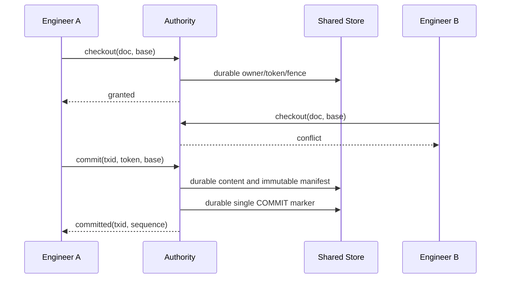

# Concurrency Protocol and State Machines

## Checkout

```
UNLOCKED --serialized acquire+durable owner record--> HELD(token, generation, base)
HELD --verified release--> UNLOCKED
HELD --audited administrative revoke and generation increment--> REVOKED
HELD --disconnect--> UNKNOWN locally, HELD at authority
UNKNOWN --reconnect and epoch+token+generation+base check--> HELD or FENCED
FENCED --attempted publish--> DENIED
```

Two engineers requesting the same document simultaneously must serialize at the authoritative mutation point. One succeeds and the other gets an explicit conflict. Do not use check-then-create, age-based lock stealing, or local-cache authorization. Admin revocation requires a durable audit record and fencing increment. A crashed client must not automatically free its lock.

## Transaction publication

```
WORKING -> STAGING -> PREPARED -> COMMITTED -> MATERIALIZED -> INDEXED
                  \-> ABORTED       \-> RECOVERY_REQUIRED
```

1. Acquire globally serialized commit authority; recheck lock tokens, fencing generations, epoch and all expected base heads.
2. Write every CAD blob and revision manifest to unique temporary objects; fsync, verify SHA-256 and atomically rename each to an immutable content-addressed path. Flush parent directories where supported.
3. Store one immutable manifest covering the full multi-document change (metadata, BOMs, dependencies, lifecycle status, audit, content references), validate all referenced blobs.
4. Persist PREPARED record with txid, old heads and manifest digest.
5. Atomically publish and durably flush a **single** immutable commit marker. It is the linearization point. Do not send success before this.
6. Rebuild materialized document heads and contiguous journal projection as needed. Clients must first check recovered committed generation, not stale head files.
7. Respond with transaction ID and ordered sequence; on lost acknowledgment, query txid rather than creating a second revision.

## Idempotent recovery

Absent COMMIT: prepared data is not visible and may be collected after a safe retention interval. Present COMMIT and valid immutable objects: transaction is authoritative; rebuild projections idempotently. COMMIT with missing/corrupt objects, diverged heads or a journal gap: fail closed, require operator repair. Reconnect checks workspace epoch, checkout fencing and object hashes; never overwrite based on cached locks.

The isolated prototype has an intentional safety limitation: its mkdir mutex can be left behind by a crash; removing it while a live writer remains active would break exclusivity. It is therefore not suitable for production without a stronger service or proven fencing protocol.


